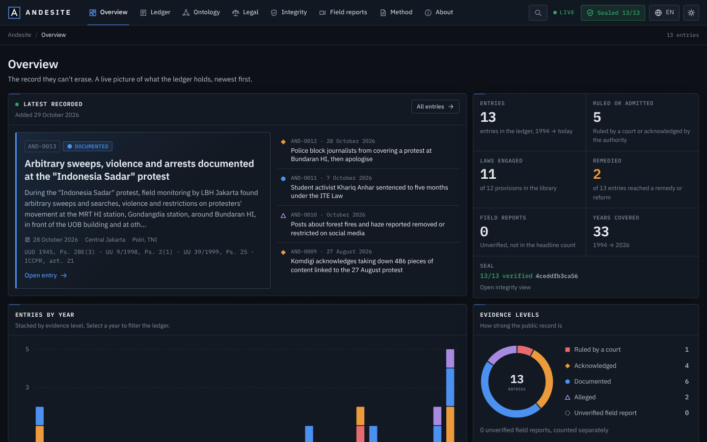
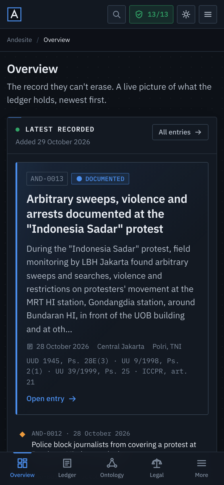
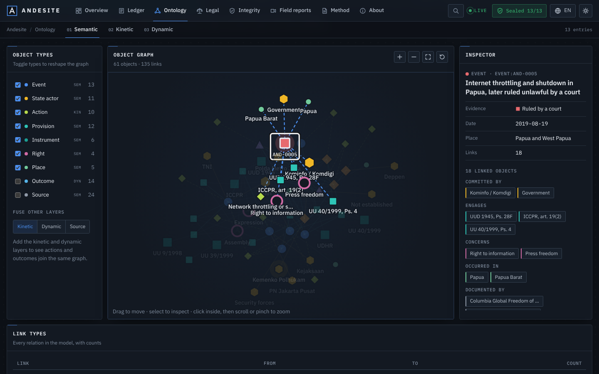
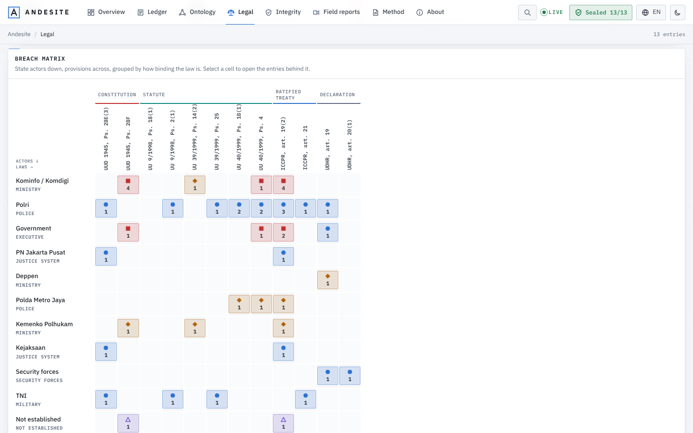

# Andesite

**A permanent, open source ledger of documented and alleged violations of press freedom and civil liberties by the Indonesian state.**
*The record they can't erase.*

| Desktop | Phone |
|---|---|
|  |  |
|  |  |

## Why it exists

Press freedom, freedom of expression, freedom of assembly and the right to information are written into Indonesian law and into treaties Indonesia has ratified. When those rights are violated, the record ends up scattered across news articles, NGO reports and social media posts, and some of it disappears. During protests, journalists are kept away, content is taken down and the first record of what happened is often a post that gets deleted.

Andesite keeps that record in one place. Every entry has a date, a place, the state actor involved, sources you can open, and the exact laws it relates to, quoted in the original language with a translation underneath. Nothing is ever deleted. The site is available in English, Bahasa Indonesia, Nederlands and Deutsch.

Andesite records documented and alleged events. It is not a court and it does not issue verdicts.

## What's on the site

Andesite is laid out like an operations console: a set of pages you move between, not one long scroll.

| Page | What it shows |
|---|---|
| **Overview** | The most recently added entry first, then key figures, entries by year, evidence levels, a map, the rights affected, the accountability gap and the most engaged laws. Every chart links into a filtered ledger. |
| **Ledger** | Every entry with search and filters that live in the address bar, and a split-pane object view: summary, properties, linked objects, what happened next, the laws quoted in full, sources and the entry's place in the hash chain. |
| **Ontology** | The fusion layer, in three tabs. *Semantic*: a live graph of every object and link, with an inspector. *Kinetic*: actor to action to provision flows, the action catalogue and the steps by which the record itself can change. *Dynamic*: replay the ledger year by year, evidence to accountability flows, and response lanes on one time axis. |
| **Legal** | "Which laws did the state breach?" A matrix of state actors against provisions, each cell marked with the strongest evidence behind it, the legal hierarchy from the Constitution down, and a dossier per provision. |
| **Integrity** | The hash chain drawn block by block and verified live in the browser. |
| **Field reports, Method, About** | Unverified posts counted separately, and the long-form rules. |

On a desktop every page sits in the top bar. On an iPad in landscape the main pages stay in the bar and the rest move to the menu; in portrait the menu takes over, with a breadcrumb and page tabs underneath. On a phone there is a bottom tab bar plus the menu, which holds every page, the language and the theme. Press `/` (or Ctrl/Cmd+K) anywhere to search entries, actors, laws and pages.

## How to read the evidence levels

| Level | Shape | Meaning |
|---|---|---|
| Ruled by a court | ■ | A court ruled the act unlawful or unconstitutional. |
| Acknowledged | ◆ | The responsible authority publicly admitted the act. |
| Documented | ● | Documented by credible independent monitors or several credible outlets. |
| Alleged | △ | Credibly reported, but the act or the responsibility for it is not confirmed. |
| Unverified field report | ◌ | Public social media posts showing an incident, not yet confirmed. Counted separately, never in the headline number. |

Please check the evidence level before you share an entry. Full rules: [METHODOLOGY.md](METHODOLOGY.md).

## How the seal works

The ledger is a hash chain. Each entry is converted to one canonical JSON string and hashed together with the hash of the entry before it:

```
h0 = sha256("ANDESITE-GENESIS-v1")
hn = sha256(h(n-1) + canonical(entry n))
```

The hashes are published in [`data/ledger.lock.json`](data/ledger.lock.json). Your browser recomputes the whole chain on every visit and shows the result in the header ("Ledger sealed · 13/13 entries verified"). If one character of an old entry changes, the badge turns red and a banner names the first broken entry. On GitHub, CI rejects any pull request that edits, reorders or removes a sealed entry. Corrections are published as visible amendments in [`data/amendments.json`](data/amendments.json).

## How it updates itself

A GitHub Action runs every six hours. It reads news and NGO feeds (AJI, SAFEnet, CPJ, HRW, Amnesty, Tempo, Antara, Asia Pacific Report, and GDELT news searches), keeps articles from an allowlist of credible publishers that mention a covered right, a harmful act and Indonesia, and asks Claude to group them into events and draft entries in four languages. Code then decides what gets sealed: at least two independent publishers, every link loading, the event recent, no duplicate, laws only from the library, no private individuals, and an evidence level that can never be set above Documented. Automated entries carry an "Auto-recorded" badge until a person reviews them. The site polls the ledger every two minutes, so open pages show new entries without a refresh.

To switch it on, add an `ANTHROPIC_API_KEY` repository secret. Without it the monitor stays idle and the ledger only grows through reviewed pull requests.

## How to contribute

You do not need to write code.

- **Report an event:** [new entry form](https://github.com/SteveBehren/Andesite/issues/new?template=new-entry.yml)
- **Report a social media post:** [field report form](https://github.com/SteveBehren/Andesite/issues/new?template=field-report.yml). GitHub issues are public; read [SECURITY.md](SECURITY.md) first.
- **Fix a mistake:** [correction form](https://github.com/SteveBehren/Andesite/issues/new?template=correction.yml)
- **Improve the code or a translation:** see [CONTRIBUTING.md](CONTRIBUTING.md)

```bash
npm ci
node scripts/validate.mjs && node scripts/seal.mjs   # after adding an entry
node scripts/verify.mjs                              # recompute and check the chain
npm test                                             # unit tests
npx serve .                                          # run the site locally
```

## Engineering notes

- **No framework and no build step, on purpose.** The site is one HTML file, one stylesheet and a handful of plain ES modules (one per page in `assets/js/views/`) that read plain JSON. Charts, the force-directed graph, the Sankey flows and the dot-matrix map are hand-written SVG with no chart library. Anyone who can edit a JSON file can contribute, and the site will still open in ten years.
- **An ontology on top of the seal, not inside it.** `data/ontology.json` classifies who acted, how, and what happened next. It is validated against the entries and the law library, but it is not hashed, so the classification can improve without ever rewriting a sealed entry. Unclassified entries fall back to actors matched from their text.
- **Motion that respects the visitor.** Panels, charts and graphs animate in, but every animation is CSS or `requestAnimationFrame` driven and switches off under `prefers-reduced-motion`.
- **Append-only data with CI enforcement.** `seal.mjs` refuses to rewrite an existing hash. `verify.mjs` checks on every pull request that the base branch's lock is an exact prefix of the new one.
- **One canonicalisation module for browser and Node.** [`assets/js/canonical.js`](assets/js/canonical.js) is imported by the page (Web Crypto) and by the scripts (Node crypto). A unit test proves both produce the same chain for the real ledger.
- **Four-language content pipeline.** Entries carry `en`, `id`, `nl` and `de` text; UI strings and the About and Method pages live in `i18n/*.json`. The validator fails if any language is missing a key or if any text contains an em or en dash. Dates are formatted per locale with `Intl`.
- **Law texts are data with provenance.** Each provision in [`data/laws.json`](data/laws.json) holds the verbatim original, translations labelled official or unofficial per language, and the official source URL.
- **The evidence model drives the UI.** Each level has a colour and a distinct shape, so colour is never the only signal. Field reports are excluded from the headline number by design.
- **Safety by design for social media reports.** Links only, no embeds, no archive links for social posts (a deleted post stays deleted), city-level locations, no private names, and no scraping of social platforms.
- **The model proposes, code decides.** The automated monitor uses structured outputs; every sealing rule is a deterministic, unit-tested function in [`scripts/scan-lib.mjs`](scripts/scan-lib.mjs).
- **Strict Content Security Policy.** No inline event handlers, no inline styles (chart geometry goes through the CSSOM), one hashed inline script, no third-party scripts. The validator checks that the CSP hash matches the inline script.

## Roadmap (V2)

- A semi-automated **social media monitor**: keyword watchlists, and a manual review queue where a maintainer checks posts against the field report checklist before anything is filed. No automatic publication of social posts.
- A review dashboard for automated entries (mark reviewed, promote, withdraw) that writes amendments through pull requests.
- Per-entry permalinks with Open Graph previews, and a JSON and CSV export with the seal included.
- More categories (for example religious freedom and indigenous land rights) and regional filters.

## Licences

- Code: [MIT](LICENSE)
- Data and written content: [CC BY 4.0](DATA_LICENSE)

Built by Stephen, https://github.com/SteveBehren
